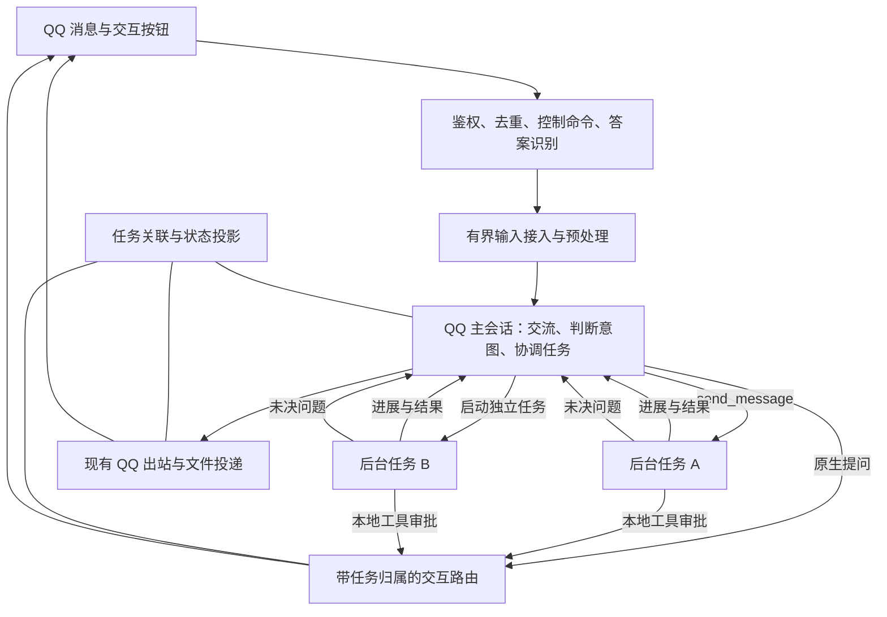

# QQ Bot 持续对话与后台任务方案

状态：本次代码与本地验收交付已完成；真实 QQ 联调作为后续上线检查。日期：2026-11-06。

本方案基于 dsh-qqbot `0.5.5`（提交基线 `14d5eef`，包含当前工作区尚未提交的持续对话实现）及本机 DeepSeek Harness `0.2.2-rc.1` 源码（`fcc0ad462172522aaf5c93a7b2e01f6b9f0b0159`，下文简称 `fcc0ad4621`）。尚未验证正在运行的 QQ 部署，应以实际宿主版本和会话 preset 做组合验收。

### 本次复核基线

| 对象 | 2026-11-06 复核结果 |
| --- | --- |
| 本机 Harness 检出 | `/home/ops/Git/deepseek-harness`，版本 `0.2.2-rc.1`，HEAD 为 `fcc0ad4621`，工作区无未提交改动 |
| 与本文原引用比较 | 提交一致；本次未发现更新的本机源码，继续固定到完整提交引用 |
| QQ 插件工作区 | 已有 interactive 接入、任务登记、原生问答和生命周期实现；正文按当前代码更新，不再将已实现功能列为待开发 |
| 验证范围 | 复核源码、配置和既有本地测试记录；本次文档修订未重跑测试，也未进行真实 QQ 联调 |

当前宿主能力结论：后台委派使用统一 managed activation；消息可在同一子代理树内互发；主会话提问可使用原生 timed 模式；子代理的问题由主会话转述；模型切换可在下一步骤原地生效。`steer()` 负责步骤间补充，`followup()` 仍进入下一轮队列。宿主升级本身不会切换 QQ 的接入模式，插件默认仍为 `serial`。

## 实施记录

以下记录与正文描述当前工作区实现；操作入口同时见 [README](../README.md)。源码复核、本地组合验证和真实 QQ 发布验收分别记录。

本次交付范围已经确认：交付代码、配置说明和本地验收即可。真实 QQ 私聊／群聊联调不属于本次交付，保留为后续上线检查，不阻塞本次完成。

| 交付项 | 已实现的入口与验证 |
| --- | --- |
| 逐条即时接入 | `conversation.mode: interactive`；[接入队列](../src/middleware/admission.ts)只串行预处理和提交，保留原始输入 ID；双层数量/字节限额；截止时间与停止均使旧 ticket 失效 |
| 根生命周期 | [SessionManager](../src/session/session-manager.ts)负责 generation、创建取消、关闭屏障、exact root drain/dispose、历史恢复和原地模型选择；借用宿主根无 dispose 能力时拒绝整树关闭，但允许重置 QQ 关联以开始新会话 |
| 任务状态与权限 | [TaskRegistry](../src/features/task-registry.ts)按 runId 观察 native start/end、保存结果/进展/文件；普通命令与模型任务工具均校验发起人，首版只允许根直接委派 |
| 问答与审批 | 原生 waterfall、timed pending/迟答、按钮 nonce、显式 `/answer`、引用卡片与独立并发审批；子任务问题由根代问，`questions[].id` 使用 `<taskId>:<questionId>` 固定任务归属，不同所有者分开提问 |
| 结果发送 | [TaskReporter](../src/features/task-reporter.ts)提供 `qqbot_report_task`，只发送已保存的本次执行结果/交付物；按真实 QQ 回执记送达或失败，已确认结果幂等跳过；`/task` 可重新查询保存结果 |
| 出站与保活 | 流式缓冲固定原窗口，后续消息使用新窗口；整轮发送包含文件均保活；主回复停止保留流式收尾；重置后的旧根事件不进入新会话 |
| 配置与回退 | 设置面板“执行中接收新消息”开关映射 `interactive/serial`，默认关闭；仅更新 mode，保留高级参数；`processingTimeoutMs` 保留 serial 职责，交互模式独立配置接入/主回复/任务期限 |

自动验证入口：`pnpm test`（单元与 SDK 命令测试）、`pnpm test:native`（真实本机 Harness 源码组合；模型和 QQ 网络用可控替身）、`pnpm build`、`pnpm typecheck:client`。原生测试覆盖真正的 inbox 消费、两个后台 activation、群任务工具权限、timed 问答投影和审批审计；复现方法见 [测试说明](../tests/README.md)。不能把这些测试当作真实 QQ 账号的送达证明。

2026-11-06 已有本地验收记录：40 个单元测试文件、408 个测试通过；4 个原生组合测试文件、14 个测试通过；构建、客户端类型检查和 `git diff --check` 通过。该次验收已按实现源码重新构建 `lib/`；测试没有修改本机 Harness 源码或连接真实 QQ。这些结果保留为既有实现的验证记录，不代表本次文档修订重新执行了测试。

2026-11-08 修复借用宿主会话无法 `/new` 的问题：重置可请求取消旧主回复并解除 QQ 关联，新 ID 的保存纳入关闭屏障，避免并发 `/stop` 导致重新借用旧根。旧宿主会话与后台任务保留，未确认结束的任务标记为“状态待核实”；新增命令、并发和真实宿主回归测试。本次验证通过 40 个单元测试文件共 444 个测试、4 个原生组合测试文件共 16 个测试，以及构建、客户端类型检查和 `git diff --check`；已更新 `lib/`，未连接真实 QQ。

已明确保留的边界：不实现宿主进程重启后自动续跑；不承诺强制中断已开始的外部操作、严格用户消息优先消费或跨网络恰好一次投递。来源目录没有对应依赖时原生测试需补齐测试依赖，业务插件不因此增加对宿主内部包的硬依赖。发布前仍需用授权的 QQ 测试私聊和群验证按钮、提及门控、流式显示、延迟发送及文件；在完成前不将整套 QQ 部署标记为已验证。

## 1. 目标与推荐方案

让用户交代任务后，仍能在同一个 QQ 对话里继续聊天、补充要求、查询进度和安排其他任务。耗时工作在后台推进，结果、问题和失败信息回到原对话。

推荐使用 **QQ 主会话负责交流与协调，dsh 原生后台子代理负责耗时工作** 的结构。消息入口只等待输入被宿主接收，不等待整个任务结束；执行中补充通过 `steer()` 进入下一执行步骤。复用宿主的子代理、消息传递和生命周期能力，插件承担 QQ 输入、任务与受众关联、交互卡片和结果投递。

实现按两阶段组织，两阶段代码与本地验证均已完成：

1. **执行中可补充**：解除整轮等待，接入 `steer()`，解决问答误拦截、停止竞态、输入积压和超时语义。
2. **后台多任务可协作**：使用原生 managed activation，补齐任务查询、主会话代为提问、本地子任务审批、定向停止、结果回报和根会话保活。

第一阶段改善插话体验；第二阶段提供本文所述“后台做事、前台继续交流”的能力。实际 QQ 部署的完整体验仍需通过第 8、9 节的联调验收。

## 2. 参考产品及设计启示

| 参考 | 官方说明中的行为 | 本项目借鉴点 |
| --- | --- | --- |
| OpenAI dot | 后台代理可并行工作；用户仍能聊天、调整优先级、补充指令 | 主对话持续可用，长任务有独立上下文与执行生命周期 |
| Grok Bot | 用户直接消息优先于后台工作，可以改变当前执行方向；Bot 之间可异步交接 | 用户输入及时接收，后台更新不阻塞对话入口 |
| Grok Bot 更新日志 | 繁忙时先回复用户，再处理其他 Bot、Cloud Agent 和后台任务积压的更新 | 区分用户消息与任务通知，避免通知洪峰挤占交流 |

来源：[OpenAI Docs：Tasks and memory](https://learn.chatgpt.com/docs/dots/tasks-and-memory)、[Grok Bot：Message and collaborate](https://docs.x.ai/grok-bot/chat-and-collaboration)、[Grok Bot Changelog，2026-09-25 v0.59.0](https://x.ai/changelog/bot)。

以上资料说明产品行为，不能据此断言其内部队列或代理调度实现。下文是针对 dsh-qqbot 的实现设计。

## 3. 用户体验与范围

### 3.1 典型对话

| 用户输入 | 预期行为 |
| --- | --- |
| “帮我整理这周的资料” | 接收任务，交给后台执行，简要说明已开始 |
| 执行中说“按项目分组，别按日期” | 关联原任务，转交补充要求；接收成功后才能说已转交 |
| “现在做到哪了？” | 根据真实任务状态、最近进展回答，不等原任务完成 |
| “另外查一下这个报错” | 建立独立任务；已有工作继续进行 |
| “停掉资料整理，报错继续查” | 只停止指定任务，反馈实际停止状态 |
| 有任务等待回答时，用户聊其他话题 | 普通聊天正常进入主会话，不能被当成问题答案 |
| 用户暂时不发消息 | 后台继续工作；完成、失败或需要回答时通知原 QQ 会话 |

短问题直接在主会话回答。多步骤、耗时或需要等待外部结果的工作优先委派。用户无需学习任务命令即可进行常见操作；任务命令作为明确控制与故障排查入口。

### 3.2 首版边界

- `steer()` 在下一执行步骤生效，不承诺立即中断已经开始的模型请求、工具调用或外部操作。
- 同一主代理仍按宿主规则执行；并行来自后台子代理，不是在同一个会话状态上同时启动多个执行循环。
- 后台任务需要宿主进程存活；持久化会话不等于进程重启后自动恢复执行。
- 首版不包含跨设备连续运行、定时监控、长期记忆系统或新的管理网页。
- 并行任务修改同一文件或共享资源时必须协调；不将“后台执行”解释为可以无约束并发写入。

## 4. 当前实现与宿主能力

### 4.1 QQ 插件当前行为

| 位置 | 已确认行为 | 生效条件与边界 |
| --- | --- | --- |
| [middleware-setup.ts](../src/gateway/middleware-setup.ts)、[admission.ts](../src/middleware/admission.ts) | serial 使用 SDK `concurrencyGuard/merge`；interactive 只串行预处理和提交 | 控制命令与明确作答在普通消息队列之前处理；interactive 有接入期限与数量限制 |
| [inbound.ts](../src/transport/inbound.ts)、[session/types.ts](../src/session/types.ts) | interactive 登记来源后调用 `steer()` 并返回；serial 保留 `followup()` 后等待 `whenIdle()` | 缺少 steer 时明确报错；接收不等于模型已经读取 |
| [session-manager.ts](../src/session/session-manager.ts) | 创建去重、generation 失效、关闭屏障、根实例释放和历史恢复 | 关闭失败不重新开放旧根；借用宿主根缺少释放能力时拒绝整树关闭，重置只解除 QQ 关联 |
| [task-registry.ts](../src/features/task-registry.ts)、[task-reporter.ts](../src/features/task-reporter.ts) | 关联 runId、任务归属、结果和文件，按 QQ 回执更新投递状态 | 首版由根直接委派；外部后端结果可记录，但不具备后续消息能力 |
| [outbound.ts](../src/transport/outbound.ts)、[activity.ts](../src/transport/activity.ts)、[qq-input-origin.ts](../src/transport/qq-input-origin.ts) | 跟踪真实回合活动、输入来源、流式窗口及旧根输出失效 | 已开始的网络发送不能撤回；文件投递也计入保活 |
| [question-channel.ts](../src/features/question-channel.ts)、[question-answer.ts](../src/middleware/question-answer.ts) | 使用原生 answerer waterfall 和问题投影；支持 timed、迟答、按钮、引用及 `/answer` | 普通未引用聊天不当作答案；子任务由根代问，答案校验任务归属 |
| [approval-channel.ts](../src/features/approval-channel.ts) | 按请求独立登记，支持根与本地子任务审批 | 校验确切根、runId 和操作者；超时或取消不会批准 |
| [idle-evictor.ts](../src/session/idle-evictor.ts) | 回收前检查根活动、维护静止、任务、输入、待决交互和投递 | `status: idle` 与闲置时间不能单独证明可回收 |
| [commands](../src/commands/index.ts) | 任务查询、显式作答、定向停止、整树关闭、模型选择和能力状态 | 当前命令语义见第 5.5 节；模型原地切换取决于宿主能力 |

原先“等当前任务结束后才发送下一条”的行为仍适用于默认 serial 模式；开启 interactive 后，第二条消息可先被宿主接收，在下一执行步骤读取。若需要在长工具仍运行时继续回答，应将长工作交给本地后台子代理。

### 4.2 本机 Harness 已确认能力

本机 dsh 源码已提供以下能力：

| 能力 | 实际语义 |
| --- | --- |
| `followup(message)` | 进入下一轮队列，唤醒执行器 |
| `steer(message)` | 运行中在下一步接收；空闲时可唤醒新一轮 |
| `inject(message)` | 在下一步提供上下文，但不唤醒空闲代理 |
| 子代理工具／`startActivation()` | 所有委派使用 managed activation；工具完成启动接收后返回 `{ kind: 'activation', name }`，服务接口提供运行句柄；需等待检查和创建，但不等待最终结果 |
| 本地 Spawn／Fork | 可接收消息、结算后恢复；首版需要补充要求的后台任务使用这些后端 |
| 外部 Codex／Claude Code／ACP／DSH SDK 后端 | 执行单次任务，通过结算通知返回结果；不接受后续消息，不能宣称支持执行中补充 |
| `send_message` | 同一子代理树内互发，工具参数为 `agent` 名称（`lead` 或完整路径，也兼容 Session ID）；返回 `messageId` 接收凭据 |
| `interrupt_agent` | 祖先可请求停止后代；本地目标只停止当前轮，外部执行永久停止；接收停止请求不等于已经静止 |
| `list_agents` | 展示根 `lead` 与本地子代理树，不包含外部执行；`inactive` 不等同于业务任务完成 |
| `wait_agent` | 等待调用者自己的 next-step inbox 或超时，可被新输入唤醒；不代表所等业务任务完成 |
| `subagent/start`、`subagent/end` | 以 `runId` 关联执行生命周期，包含父会话、后端类型及结束结果，供任务视图使用 |
| `drainDescendants([root])` | 以运行时根为单位停止接收后代工作并收束活动，供关闭流程使用 |
| `agent.model.current()`／`select()` | 读取／记录下一步骤的模型选择；当前步骤及其重试使用已捕获选择，模型可用性由调用者验证 |
| `ask_user_question` 的 `mode: timed` | 有限等待后返回 pending，保留问题；迟到回答通过原生 `answer()` 进入后续步骤。默认 preset 仍使用阻塞模式 |

源码依据见第 12 节。旧版 `backgroundMode`、`enableRunInBackground` 和工具参数 `run_in_background` 已移除，不应再用于新版配置。子代理控制插件现在统一注册消息、查询、等待与中断工具，旧的独立 `/list-agents` 插件入口不能照搬。

当前 base 组合和 Web standard preset 已配置后台工具，但 Web 会禁用部分根作用域工具行，依靠实际 preset 装配。不能仅检查 base 配置就认定 QQ 会话可用。新版亦有可选 Agent Team 能力，默认未开启，本文不要求启用或另建团队调度系统。

**仅删除 `await whenIdle()` 并继续调用 `followup()`，会把等待移入 dsh 的下一轮队列，无法实现当前任务的步骤间补充。**

## 5. 推荐架构

宿主管理代理运行、收件箱和子代理关系；插件维护 QQ 任务归属及投递状态。任务视图从宿主事实和交付记录更新，不另建一套驱动代理运行的调度器。

### 5.1 输入接入

1. 保留访问控制、限流、去重、群聊提及规则和命令优先通道。
2. 为普通消息分配入站序号与会话 generation，保存原始消息 ID、发送者、附件和引用关系。
3. 预处理完成后，按同 peer 的接收顺序提交；串行区间只覆盖接入，不覆盖任务执行。
4. 交互模式普通输入使用 `steer()`。它同时支持空闲唤醒和运行中补充，避免依赖 `status` 判断来切换语义。明确要求下一轮处理的输入才使用 `followup()`。
5. 调用前登记 QQ 输入来源；提交失败时回滚登记、释放计数并反馈失败。提交成功只代表宿主接收，不能声称任务已完成。
6. 同轮多条输入保留各自身份与顺序，不再由 SDK `merge` 隐式拼接。宿主可能在同一步消费多条 steering 输入。

接入队列和宿主未领取输入分别限额：接入队列沿用 `maxQueue` 的职责；另跟踪已提交但仍在 inbox 中的消息数量和总大小，避免只是把无界积压移进宿主。新版可接线 `agent/inbox/inserted`、`agent/inbox/claimed`、`agent/inbox/discarded`，持久记录为 `agent/inbox/spliced`。

`claimed` 仅代表从队列领取，并不证明消息已进入模型请求：pre-step 仍可能拒绝并以 `blocked` 收尾。队列配额在 claimed／discarded 时释放；QQ 来源登记需保留到回合输入提交及结束，领取后被拒绝的路径也要清理。接收、领取、`user/message` 写入和模型实际消费分别观察，不能用一个事件代替全部状态。

附件预处理使用整条消息截止时间，当前按同 peer 顺序准备和提交；单个附件失败可保留元数据，整条接入超时则反馈失败，迟到下载结果不能再提交一次。普通文本等待前序媒体的时间受截止时间约束；停止、重置、问题回答和审批操作不等待下载。

输入状态指示改为跟随真实代理活动，不能随入站函数提前返回而结束。必要的接收提示与实际 AI 回复分开，避免每条消息都生成一条机械回执。

### 5.2 主会话与后台任务

主会话承担意图判断：直接回答、启动新任务、给已有任务补充、查询进度或停止任务。判断参考任务标题、最近上下文、用户引用的消息和明确任务 ID；多个任务都可能匹配时，仅询问必要的目标信息。

后台委派使用新版 managed activation，提交清晰目标、必要上下文和预期交付物，完成模型、目录和 activation 创建等检查后返回接收结果，不等待任务完成。首版选择进程内 Spawn／Fork，让主会话能转交补充要求；外部后端单独显示“不支持后续消息”的能力限制。默认由 QQ 根会话直接委派，沿用宿主默认的一层委派深度，降低中间创建者先结束造成的通知遗漏。

模型侧工具返回的是名称，不是 childSessionId。通过宿主目录与 `subagent/start`／`subagent/end` 关联 `childId`、完整名称和 `runId`；不能从文本 `started subagent <name>` 猜测会话 ID。每次 activation 单独跟踪，同一个本地子会话可先后接受多次工作。

主会话不阻塞等待运行句柄的 `result`；需要等待消息时可复用原生 `wait_agent`，新 next-step 输入可唤醒它。该工具只证明收件箱有输入，业务完成仍以任务结果核实；不在插件里持续轮询或使用不可被消息唤醒的长等待。

任务表保存以下关联，具体字段与每次执行记录见 [TaskRegistry](../src/features/task-registry.ts)：

| 字段 | 用途 |
| --- | --- |
| `taskId`、标题 | 用户可识别的任务与名称 |
| `appId`、`scope`、`peerId`、发起者 ID | 固定受众与操作归属 |
| `rootSessionId`、`parentSessionId`、`childId`、完整名称 | 区分运行时根、创建者与执行目标；外部 childId 不代表有可恢复的本地会话 |
| `runId`、`local`、generation | 标识本次 activation 与后端能力，隔离同一子代理的多次运行及会话重置 |
| 发起消息 ID、创建时间 | 关联原始请求与追溯 |
| 当前阶段、最近进展及证据位置 | 展示可核实的进度 |
| 结果引用、投递状态 | 分开表达任务结果与 QQ 送达情况 |

任务记录以 `subagent/start` 建立，并用 `runId` 配对结束。该 start 事件可能早于宿主最终接收确认，不能单凭它告诉用户“已成功转交”；应结合工具接收结果和失败／结束事件更新状态，创建失败不能留下“正在运行”的假任务。以事件中的 `stopReason`、最终消息和交付物更新结果；不能只依赖 `list_agents`，它不展示外部执行。仅观察到 `idle`、`inactive`、`turn/end` 或收到一条 agent 消息时，不直接标记“成功完成”。

宿主通常先释放 child，再通知创建者，之后发布 `subagent/end`，最后兑现运行句柄的 `result`。end 到达时 `agents.get(childId)` 可能已不存在；插件按本次 run 保留确切会话引用与事件范围，读取最终文本和文件。清理失败可能让 end 的 `stopReason` 为 `error`，即使已捕获业务输出也不能据此把资源关闭状态写成成功。

新版消息权限允许同一棵树中的兄弟和其他成员互发，工具目标以 `agent: lead` 或完整名称表达。业务任务归属与 QQ 操作者权限仍由插件在实际操作层校验；“同树可联系”不代表可以操作同群其他人的任务。

### 5.3 用户输入与后台通知

用户输入及时进入主会话；后台进度不能占用用户接入队列。通知分为需要用户处理、最终结果、普通进展，普通进展可合并，最终结果和待决问题应保留可查询记录。

宿主原生通知可能已经进入同一个 inbox。公共 `agent.inbox` 有 prepend／splice，但这些操作本身不唤醒，`steer()` 则是追加；下一步可能领取全部 next-step 输入。因此单纯把用户消息放到前面不等于延后后台通知。首版不改写已接收的输入，保证入口畅通、主会话不长时间等待后台任务；严格的用户优先消费策略须另行设计并验收。

后台结果由主会话统一对外汇报。宿主结算消息为 `source.kind: subagent-settled`、`form: notice`，带执行结束原因；若子代理结束前最后已向创建者发消息，结算通知可能省略最终正文。该省略只影响通知，不会因此删除 `subagent/end.lastAssistantMessage`；后者也可能因没有输出或清理错误而缺省。需要合并进展／结果消息与结算事实，不能把通知正文缺省当作结果丢失，也不能重复汇报。

自动通知只发给仍在线且仍属于原树的直接创建者。新版允许中间创建者退出后后代继续运行，恢复目标子代理也不自动恢复创建祖先；因此不能假设根会话必然收到所有后代通知。首版采用根直接委派；若启用更深树，必须以根作用域的生命周期事件覆盖全部后代，并另行设计缺失创建者时的汇报。

通知去重依据执行 `runId` 与稳定事件／交付标识；QQ 发送失败保留结果和失败状态，重试投递不重新执行任务。网络超时可能存在“已送达但未确认”，不能宣称跨网络绝对只发送一次。

### 5.4 主会话提问与子任务审批

原生 `askTimed` 要求存活 agent；`userQuestions.ask` 在请求带 agent 时也检查它是 registry 中的确切存活根代理（普通 ask 服务另允许不带 agent 的请求）。`origin: subagent` 的调用会被 `DELEGATED_CALLER` 拒绝。QQ 模型提问沿用根身份校验；子代理将未决问题写入给主会话的消息或最终结果，由主会话提问，收到答案后再用 `send_message` 继续对应本地任务。

主会话优先复用原生 timed 提问，不另造一套持久问题状态机。QQ 会话的 `tool-ask-user` preset 行需显式配置 `mode: timed` 和有限 `timeout`（工具配置单位为秒）；默认工具模式为 legacy 阻塞提问。直接调用 `askTimed` 的服务参数则是毫秒。有限期限到达后返回 `{ pending: true, callId }`，主代理可继续独立工作，问题仍保留。`timeout: -1` 走阻塞 ask，不带 `wait.timed`，当前 QQ 仍会应用 `askTimeoutMs`（默认 5 分钟）；到期取消而非转成 pending，不能理解为 QQ 必定无限等待。超时从不代表用户回答或批准。

QQ 适配已从替换 `userQuestions.ask` 改为监听 `user-questions/request` waterfall，不属于 QQ 的请求调用 `next()`。这样宿主仍执行 live-root、问题结构和 presentation intent 校验。有限 timed 等待由宿主无人认领时的截止时间管理；QQ answerer 监听 `request.signal`，收到超时 abort 后及时拒绝前台 Promise，否则 `askTimed()` 仍会等待。该拒绝只结束前台等待，保留持久问题及卡片关联。首版 QQ 不持有 `attachWait` claim，因为 QQ 没有可靠的编辑／离线状态。未来若使用 claim，必须同时实现宿主剩余时间、客户端超时和释放逻辑，不能仅保持连接。

区分两条回答路径：

- `open`：工具尚在等待，通过原请求的 answerer 完整返回答案。
- `continued`：工具已经返回 pending，通过原生 `userQuestions.answer(agent, callId, { answers })` 回答，形成带原 callId 的 `user-question-reply` steering 消息，不修改已结束工具的结果。

问题列表读取宿主 `userQuestions` projection，QQ 只持久保存卡片、受众和任务关联：sessionId、callId、scope／peer、owner、nonce、消息引用、taskIds／taskRuns 及 dismissed。运行时另核验确切会话记录和 generation，题目 ID 与内容以宿主问题为准。有限 timed 超时只结束前台 Promise，保留仍可回答的问题；不应用 `askTimeoutMs` 的通用取消。停止、重置等取消单独处理；重启后仅展示仍有效且归属已核实的问题。

答复入口为按钮、已知问题卡片引用及 `/answer <requestId> <内容>`；普通未引用文本继续聊天，不由模型自动代为提交。按钮校验 callId／question ID／nonce；引用关联保存 QQ 回执的消息 ID 和 `ext_info.ref_idx`，匹配入站 `refMsgIdx`。一个调用有多道题时，由同一答者完成答案批次后提交；处理 `open → continued` 的竞争，拒绝 `BAD_ANSWER`、`REPLY_QUEUED` 等重复或不完整答复，不双重提交。

子任务代问的 `questions[].id` 使用 `<taskId>:<questionId>`，同一次调用中的任务必须属于同一所有者，答复时重验 runId。携带 callId 的任务问题在 open／continued 答复时登记可信来源。额外的定向转发凭据仅在下一执行步骤允许向对应任务发送一次消息；其他任务操作仍按该步骤操作者和原任务权限校验。默认 legacy 问答不提供这项定向凭据。

timed 模式在前台等待窗口内仍会占住当前步骤；用户新消息可以入队，但不是立刻消费。即时继续聊天的场景可由主会话发普通问题后结束本轮；需要表单的场景选用经验证的有限等待，保留这个延迟边界。

工具审批是独立路径。对本地子代理，核验其运行时根、任务、活跃请求后，将 `approval/request` 路由到原 QQ 受众，并返回原请求的审批结果；仅明确同意产生 `allowed-once`，取消或不可用均不授权。审批跟随原请求 signal，没有 QQ 侧的 timed 继续执行语义。`userQuestions` 的 `intent: approval` 也是阻塞、固定动作的问题，禁止任何 `request.wait`（包括 `timeout: -1` 产生的 wait）；它不等同于工具审批服务，更不能由插件推导额外授权。外部后端的权限处理各自独立，首版不承诺通过 QQ 接管它们的交互审批。

群内任务控制默认限任务发起者及 `conversation.taskAdmins` 中的管理者；卡片校验请求、作用域和操作者。任务控制权限在实际操作／工具执行层校验，覆盖自然语言触发的补充和停止。宿主的同树通信权限不包含 QQ 发言者身份；插件从已验证入站记录取得操作者，不能依赖模型自报身份。审批 pending 使用独立 nonce 绑定原 request／signal、确切根及 child runId，与宿主审批审计 ID 分开；重复点击、旧题按钮和重置后的卡片不完成新请求。

### 5.5 停止、重置和会话生命周期

当前任务与会话控制入口如下：

| 操作 | 当前语义 |
| --- | --- |
| `/stop` | 停止主会话当前生成；说明后台任务是否仍在运行 |
| `/tasks`、`/task <taskId>` | 展示任务、等待事项及已保存结果；查询不重跑任务 |
| `/answer`、`/answer <requestId> <内容>` | 查看待答问题或明确作答 |
| `/stop <taskId>` | 请求停止指定任务的本次执行，反馈“停止中／已停止”等真实状态；本地后代不随中断自动停止 |
| `/stop all` | 关闭当前树、收束任务并释放根实例，保留会话历史；下一次输入恢复新的根实例 |
| `/new`、`/reset`、`/clear` | 开始新会话并清理 QQ 待决交互；插件自有旧树关闭，借用宿主的旧根仅解除 QQ 关联并明确提示保留状态 |
| `/model provider/model` | 有 `agent.model.select()` 时验证后在下一步骤原地生效；旧宿主只保存新会话偏好；已存在的子任务不会自动改模型 |
| `/preset` | 保存新会话的 preset 偏好，不重建当前根 |
| `/bot-status` | 查看实际模式、steer、可见后台工具和模型原地切换能力 |

整树关闭要求插件持有根的释放能力。借用宿主已持有的根时，`/stop all` 明确拒绝，并提示可用 `/new` 切换。新建／重置请求取消旧主回复、清理 QQ 待决交互、使旧输入和输出关联失效，并保存新的会话 ID；不等待旧根整体静止，也不调用 `drainDescendants` 或伪造释放句柄，宿主中的旧会话及历史仍保留。旧后台任务尚未确认结束时，通过 `forgetRoot` 标记为“状态待核实”，回复明确提示需在宿主中查看或停止；不宣称整树已取消。主回复停止仍可用。

`interrupt_agent` 对本地目标只停止当前轮，保留排队消息和后代；对外部执行永久停止。`activation.dispose()` 也仅释放确切的那次 activation，不递归释放后代。停止任务子树不能伪装成一次单目标中断；首版按根直接委派控制范围，扩展深层任务前补齐子树停止规则。

新版 `drainDescendants([root])` 会关闭该确切根的后代接入，直到根离开 registry，没有 reopen 操作。它用于重置、卸载、关闭，以及按上表定义会释放根的 `/stop all`；不能 drain 后继续拿旧根创建任务。关闭失败或恢复失败应明确报告，不能先宣称已停止并立即接收依赖旧根的新工作。

主代理 `cancel(cause)` 默认清空两类 pending inbox，显式 `keepInbox: true` 才保留。取消收敛期间新 waking 输入会排到下一轮，故入站 generation 防护仍然必要。`whenIdle()` 只观察整个代理活动静止，不代表某条消息或所有子任务已完成。

停止或重置必须使命令前未提交的接入工作失效。generation 在重置／关闭时更新，入站提交前再次核对；晚到的下载、创建结果、计时器或通知不能重新启动旧任务或写入新会话。命令之后的新消息正常接收。

回收条件改为同时满足：确切根代理无活动、无维护任务、无在途接入、无未结束后台 activation、无待答／待批请求、无关键投递待完成，且超过闲置期限。维护任务期间公开 `status` 仍可为 `idle`，不能只读这个字段。活动状态未知时不贸然回收，记录诊断并核对；确认活动结束后仍需释放资源。

插件卸载、会话重置和进程关闭使用统一关闭流程：停止接收新任务，失效旧 generation，清理待决交互和计时器，调用宿主关闭流程收束后代，再释放根代理。新版不能再依赖已移除的 `drainContinuable*`、`AgentRegistry.parentAgent/isOwnedBy/roots` 等旧接口；树归属由子代理服务核验。持久记录保留必要结果；重启后未完成任务先标记“状态待核实”，不自动重复执行可能已经发生的操作。

当前 QQ `/model` 已适配 `model.current/select`：先核验 provider、model 及文本输入输出能力，再由宿主记录 `model/selection`；选择不会主动唤醒代理，已准备步骤及其重试不变。旧宿主缺少该接口时只保存新会话偏好，不再通过 fork／重建切换。没有使用已 deprecated 的 `agent/request` 监听改模型路由。

### 5.6 超时与 QQ 投递

serial 模式的 `processingTimeoutMs` 传给 SDK 的 `maxProcessingMs`，没有由插件明确接到 `agent.cancel()`，不能认定它保证取消底层执行。interactive 不使用该 SDK 期限；主回复期限由 [ConversationActivity](../src/transport/activity.ts) 接到 `manager.stop(main)`，同时取消当前主轮并使旧接入失效。

交互模式分别处理接入期限、主代理运行期限、后台 activation 期限和问题等待期限；工具审批跟随原请求 signal。主代理计时器绑定具体 session、generation 与 turn；后台超时、延迟停止和异步控制绑定本次 `runId`／确切 activation，不能只绑定 peer、taskId 或 childId。调用按 childId 寻址的中断前核对当前 runId，过期回调失效；释放使用当次句柄，避免旧控制操作影响同一子代理后来的运行。

`QqInputRegistry` 已调整保留策略：已接收未领取的输入及已领取但尚未结束的回合输入不会只因为接入超时较短就过期，正常释放跟随回合／丢弃／拒绝结果；claimed 不立即释放来源身份，TTL 用于非活动记录的兜底清理。原生迟到回答保留 `user-question-reply` 来源，并核验其 QQ 受众，不伪造成新的普通用户输入。

出站沿用现有 QQ 流式与被动回复窗口处理：已打开的流固定原 msgId，后续输出可使用同 peer 的新窗口；后台结果保持任务创建时的受众。窗口过期按现有发送能力降级，平台拒绝时记录投递失败。首版不得承诺任何时间、任何会话都一定能主动送达。

## 6. 配置与兼容策略

以下配置已接入 [ConfigSchema](../src/config.ts)。`conversation.*` 位于插件 `config.conversation`，其余位于插件 `config`；开启示例见 [README](../README.md)。

设置面板在“基础设置”中提供独立的“执行中接收新消息”开关。开启写入 `conversation.mode: interactive`，关闭写入 `serial`；服务端只接受 mode 子字段，并在 profile 中保留已设置的其他 conversation 参数。保存触发既有插件重载流程，应在当前任务完成后切换；开关不代表能立即打断长工具，也不替代后台工具的 preset 装配。

| 配置 | 默认值 | 当前职责 |
| --- | --- | --- |
| `conversation.mode` | `serial` | 显式设为 `interactive` 开启步骤间补充和后台协作接入 |
| `maxQueue` | `20` | interactive 限制接入中的消息数；serial 保留 SDK merge 队列职责 |
| `conversation.admissionTimeoutMs` | `30000` | 从收到消息到宿主提交的截止时间，包括排队、附件准备和会话创建 |
| `conversation.maxPendingInputs` | `32` | 每会话已提交、宿主未领取的输入数量上限 |
| `conversation.maxPendingBytes` | `262144` | 同上，按 UTF-8 字节限制 |
| `conversation.mainTimeoutMs` | `1800000` | 主代理每轮期限；`0` 不设运行期限 |
| `conversation.taskTimeoutMs` | `3600000` | 每次后台 activation 期限；`0` 不设运行期限 |
| `conversation.taskAdmins` | `[]` | 可操作群内其他用户任务的 QQ OpenID |
| `processingTimeoutMs` | `1800000` | 仅 serial 使用的 SDK 处理期限，不保证取消底层执行 |
| `askTimeoutMs` | `300000` | 非有限 timed 的 QQ 问题等待期限；`<=0` 不设置此期限；不替代原生有限 timed 的 pending 语义 |
| `sessionIdleTimeout` | `1800000` | 仅回收满足无活动条件的会话；`<=0` 禁用回收 |

后台并发与预算使用宿主限制；新版 `maxActiveSubagents` 默认 8，覆盖同树本地和外部 activation，满额立即拒绝，不自动排队。它是宿主子代理服务配置，不属于上述 QQ 插件字段。

不添加未经接线的 `.env.example` 开关。正式配置应通过插件 Schema、宿主组合或会话 preset 生效，并在 README 中说明。

当前入口检查 `steer`，后台能力检查 `startActivation/rootOf/drainDescendants` 和实际可见工具，迟答在使用时检查原生 `answer`，模型切换检查 `model.select`。这些不是覆盖所有版本的统一预检；实际 preset 的本地后端、生命周期组合及 timed schema 仍需部署核实。缺少 `steer` 时交互接入明确失败，可切回 serial；只有 steer 而没有本地后台工具时可提供执行中补充，不承诺后台多任务。不要将已移除的后台开关混入新版配置。

原生 timed 提问通过现有 `tool-ask-user` 的 `mode: timed`／`timeout` 配置启用，位置是当前会话 preset 的 `config.plugins` 行，不能把这一插件行当作顶层 patch 操作。只在 QQ 所用 preset 中启用，并验证实际加载的模型工具 schema 包含 timed 参数。推荐有限等待，例如 `timeout: 30` 秒；`askTimeoutMs` 的取消与有限 timed 的 pending 是两种不同结果，`timeout: -1` 的 QQ 行为见第 5.4 节。阻塞审批不使用 timed 降级。

新配置缺省保留 serial。迁移到 interactive 时，分别设置接入、主回复和任务期限；不能继续把 `processingTimeoutMs` 当作交互模式的总超时。当前已验证的宿主源码版本为 `0.2.2-rc.1 / fcc0ad4621`，其他版本以能力检查和组合验证为准。

## 7. 代码改动范围

| 模块 | 已实现职责 |
| --- | --- |
| `src/gateway/middleware-setup.ts`、`src/middleware/admission.ts` | 分离控制通道与普通接入，替换交互模式的整轮 merge 等待 |
| `src/transport/inbound.ts` | 接收后返回、steer 提交、失败回滚、generation 核验 |
| `src/middleware/attachment.ts` | 有界预处理、截止时间和迟到结果失效 |
| `src/session/types.ts` | 声明插件使用的 steering、模型选择、inbox 与子代理服务最小接口；各使用点检查可用能力 |
| `src/session/session-manager.ts`、`idle-evictor.ts` | 根活动追踪、保活、drain 后释放／恢复、模型原地切换 |
| `src/features/task-registry.ts`、`task-reporter.ts` | 关联 runId／childId／name 与 QQ 受众，按生命周期事实保存结果，通过 `qqbot_report_task` 发送已保存结果／文件 |
| `src/features/question-channel.ts`、`approval-channel.ts` | 问答改为 waterfall，复用原生 projection／answer；本地子任务审批独立路由 |
| `src/features/question-card-store.ts` | 持久保存 QQ 卡片与原生问题关联，问题状态仍以宿主投影为准 |
| `src/middleware/question-answer.ts`、`src/commands/` | 保留普通聊天入口，增加查询、作答和定向停止能力 |
| `src/prompt/` | 主会话委派与汇报规则、任务上下文；只注入实际存在的能力 |
| `src/transport/activity.ts`、`outbound.ts`、`qq-input-origin.ts` | 连续输入归属、真实运行期限、异步通知、流式边界和登记生命周期 |
| `src/config.ts`、组合配置、README | 模式开关、期限迁移、兼容要求与使用说明 |

实现复用现有宿主适配层和出站链路，没有修改本机 Harness 的 agent-loop。详细源码入口见第 4.1 节，原生组合测试入口见 [tests/README.md](../tests/README.md)。

## 8. 交付状态与后续上线检查

| 阶段 | 工作与交付物 | 当前状态 |
| --- | --- | --- |
| 本机基线 | 以 `fcc0ad4621` 核对输入、activation、问答和关闭接口 | 源码复核与本地组合验证完成；运行中的部署版本另行核实 |
| 第一阶段 A | 交互模式接入、逐条保留消息、未领取输入限额、附件截止时间 | 已实现；真实 Harness 测试覆盖长工具中追加输入、顺序和限额 |
| 第一阶段 B | timed 问答与迟答、控制竞态、独立超时、流式与回收修正 | 已实现；单元测试与原生组合覆盖，QQ 网络使用替身 |
| 第二阶段 A | 根直接委派、后台任务、runId 关联与查询、结果回报 | 已实现；原生组合覆盖两个 activation、补充、结果及权限 |
| 第二阶段 B | 主会话代问、本地审批、定向停止、根保活／恢复、模型原地切换 | 已实现并完成本地验证 |
| 本次交付 | 代码、构建产物、配置和使用文档、本地验收记录 | 已完成；按已确认范围，无需真实 QQ 联调即可交付 |
| 后续上线 | 在实际 QQ 私聊和群聊验证按钮、引用、提及门控、延迟投递、流式显示和文件 | 未执行，作为后续上线检查；本次不发送测试消息、不据此宣称部署已验证 |

真实 QQ 联调不阻塞本次代码交付。严格后台通知优先级、自动重启恢复等能力如需宿主扩展，单独评估，不属于本次实现范围。

## 9. 验收标准

下表保留行为验收标准。本次采用可控等待点、真实 Harness 源码及 QQ 网络替身验证时序和结果；真实 QQ 平台相关项目用于后续上线联调。本地测试通过不代表已经完成平台送达验收。

| 场景 | 必须满足的结果 |
| --- | --- |
| 长工具运行中连续发两条补充 | 两条独立输入均接收；当前步骤结束后的模型上下文含两条要求，顺序正确 |
| 两个后台任务运行中聊天 | 主会话可回答，两个任务不会因为这次聊天被取消或覆盖 |
| 多任务中定向修改一个任务 | 仅目标任务收到补充；无法确定目标时才澄清 |
| 待答问题期间发“进度怎样” | 进入普通聊天，不被消费为问题答案 |
| 两个子任务同时报告未决问题 | 由主会话生成独立问题调用，分别答复后转交原任务；不允许子代理直接调用提问接口 |
| timed 等待到期后继续聊天再作答 | 原调用返回 pending，问题仍可见；迟到答案走原生 answer，完整提交且不双重回复 |
| 在 open／continued 切换时作答或 QQ 重连 | 根据当前宿主问题状态完成一次答复，处理重复／不完整答案；不使用伪结果结束等待 |
| 两个本地子任务同时请求工具审批 | 独立显示并保持原请求权限和生命周期；过期、越权和重复按钮不生效 |
| 媒体下载期间 `/stop`，首次创建期间 `/new` | 旧接入失效，迟到结果不能启动旧工作或污染新会话 |
| 借用宿主会话执行 `/new`，或与 `/stop` 并发 | QQ 切换新 ID，旧输入与输出失效；旧宿主根、历史和委派能力保留；未结束后台任务显示待核实 |
| 主会话空闲但后台仍在运行或根处于维护中 | 任务可查询和停止；不能仅凭 idle 状态回收必要的确切根实例 |
| 输入超过限额或预处理超时 | 明确反馈，计数可释放；控制命令仍可使用 |
| 任务完成与新输入同时到达 | 两者均处理，结果有任务标识，不把通知当作用户补充 |
| 连续输入更新 msgId | 已打开的流正常结束，新输出使用有效窗口，不串 peer、不重复正文 |
| 停止指定任务／停止全部 | 范围正确，确认实际终止；未终止时显示停止中或失败 |
| `/stop all` 后发送新任务 | 旧根已释放，新根从保留历史恢复，可正常委派；不使用 drain 后已关闭的旧根 |
| 输入 claimed 后被 pre-step 拒绝 | 配额和来源登记正确释放，不报告“模型已看到要求” |
| 同一子代理开始第二次 activation，旧结束事件迟到 | 以 runId 区分，两次结果与状态不混淆 |
| 同一子代理第二次 activation 后旧超时／停止回调到达 | 旧 runId 的控制失效，不中断或释放新执行 |
| 外部后端完成或被要求继续聊天 | 结果可查询；明确不支持后续消息，不能因 list_agents 不显示就丢任务 |
| 子代理先发结果消息后结算 | 识别结算正文省略，不重复汇报、不误报结果缺失 |
| 根进入 wait_agent 后收到用户补充 | 等待被 next-step 输入唤醒，主对话继续，不能误认为子任务已完成 |
| 执行中切换主会话模型 | 当前步骤及重试不变，下一准备步骤使用新选择，既有子任务不自动切换 |
| QQ 发送失败、回复窗口过期 | 结果仍可查询，记录投递失败；重试不重跑任务 |
| 旧超时回调晚到、插件重载、进程重启 | 不取消新任务；不声称未核实任务仍在运行，不自动重复操作 |
| 宿主缺能力、切回 serial | 显示具体限制，原串行功能可用，既有任务按关闭流程处理 |

性能观测区分“收到 → 宿主接收”“接收 → 模型消费”“结果产生 → QQ 投递”。在无附件、会话已就绪、无拥塞的本地测试中，可将接收延迟 p95 小于 1 秒作为初始目标；这不包含网络和模型响应时间，也不意味着工具能在 1 秒内被打断。正式指标依据基线测试调整。

## 10. 风险、取舍与回退

- **主会话仍可能被长工具占住**：通过后台委派和可观察的工具耗时约束改善，单靠 prompt 或 `steer` 不能保证即时响应。
- **多任务增加资源消耗**：使用宿主并发、深度和预算限制，达到上限明确反馈，不无限创建子代理。
- **上下文与目标关联错误**：保留任务 ID、必要上下文和引用关系；不要把所有子任务完整记录反复注入主会话。
- **输出与文件归属错误**：固定任务受众，核验 generation 和父子关系，复用现有出站窗口处理。
- **重启导致执行状态不明**：保存可查询记录并核对宿主事实，首版不承诺自动续跑。

回退时切换到 serial。已有后台任务须先按关闭流程结束，或由已验证的兼容运行器继续托管；不能通过切换模式静默遗弃任务。回退不撤销已经完成的外部操作，也不删除任务结果。

## 11. 后续部署核查与扩展项

本地实现和验收已经完成。以下项目供后续上线或扩展时使用，不作为本次代码交付的前置条件：

1. 核对运行中宿主的实际版本及 QQ preset，确认本地 managed activation、控制工具和有限 timed 提问已装配；不能用旁边的源码检出代替部署检查。
2. 在实际 QQ 私聊／群聊检查按钮、引用的 `refMsgIdx`、提及门控、完整答案批次和过期卡片；协议路由已做本地验证，客户端展示和平台送达仍需实测。
3. 核对账号与会话的延迟发送能力、被动回复窗口及拒绝方式，验证主回复和后台结果不会串到其他会话。
4. 验证真实文件上传、部分成功后重试、流式显示和断线恢复。代码已保存结果并区分执行与投递状态，不承诺跨网络恰好一次发送。
5. 后续更新 Harness 源码或运行时依赖时，先复核接口与 preset，再运行 `pnpm test:native`；同时验证本项目构建，保留明确的源码提交和测试记录。
6. 若需严格用户消息优先级，单独设计宿主 inbox 调度；不能因存在 prepend／splice 就承诺先处理用户、后处理全部通知。
7. 若开放深层委派或扩展外部后端交互，补验离线创建者通知、任务子树停止和后端审批限制；不能沿用首版单层本地任务的假设。

## 12. 参考资料与代码依据

产品行为来源：

- [OpenAI Docs：Tasks and memory](https://learn.chatgpt.com/docs/dots/tasks-and-memory)
- [OpenAI Docs：Control your dot](https://learn.chatgpt.com/docs/dots/controls)
- [Grok Bot：Message and collaborate](https://docs.x.ai/grok-bot/chat-and-collaboration)
- [Grok Bot：Overview](https://docs.x.ai/grok-bot/overview)
- [Grok Bot Changelog](https://x.ai/changelog/bot)

DSH 能力依据：以下文件已按本机 `fcc0ad4621` 源码核对，引用固定到完整提交，不随上游 master 漂移：

- [Agent 输入与模型接口](https://github.com/deepseek-ai/deepseek-harness/blob/fcc0ad462172522aaf5c93a7b2e01f6b9f0b0159/packages/core/agent/src/runtime-types.ts)：输入、inbox 事件、取消与 model.select。
- [Agent 实现](https://github.com/deepseek-ai/deepseek-harness/blob/fcc0ad462172522aaf5c93a7b2e01f6b9f0b0159/packages/core/agent-loop/src/agent.ts)：输入领取、pre-step 拒绝及静止观察。
- [后台子代理工具](https://github.com/deepseek-ai/deepseek-harness/blob/fcc0ad462172522aaf5c93a7b2e01f6b9f0b0159/packages/subagent/tool-subagent/README.md)：managed activation、名称回执与后端能力。
- [子代理控制工具](https://github.com/deepseek-ai/deepseek-harness/blob/fcc0ad462172522aaf5c93a7b2e01f6b9f0b0159/packages/subagent/tool-subagent-control/README.md)：同树消息、祖先中断、wait_agent 与列表范围。
- [子代理服务](https://github.com/deepseek-ai/deepseek-harness/blob/fcc0ad462172522aaf5c93a7b2e01f6b9f0b0159/packages/subagent/subagent/src/index.ts)及[执行管理](https://github.com/deepseek-ai/deepseek-harness/blob/fcc0ad462172522aaf5c93a7b2e01f6b9f0b0159/packages/subagent/subagent/src/manager.ts)：根所有权、启动接收、结束事件顺序与关闭。
- [子代理结算消息](https://github.com/deepseek-ai/deepseek-harness/blob/fcc0ad462172522aaf5c93a7b2e01f6b9f0b0159/packages/subagent/subagent/src/continuation-messages.ts)：结算通知与正文省略范围。
- [子代理生命周期类型](https://github.com/deepseek-ai/deepseek-harness/blob/fcc0ad462172522aaf5c93a7b2e01f6b9f0b0159/packages/subagent/subagent/src/types.ts)：runId、local、父会话和执行结果。
- [原生提问服务](https://github.com/deepseek-ai/deepseek-harness/blob/fcc0ad462172522aaf5c93a7b2e01f6b9f0b0159/packages/interaction/user-questions/src/index.ts)：根身份校验、askTimed、answer 与 attachWait。
- [提问工具配置](https://github.com/deepseek-ai/deepseek-harness/blob/fcc0ad462172522aaf5c93a7b2e01f6b9f0b0159/packages/interaction/tool-ask-user/README.md)：默认阻塞、timed opt-in 和迟到回答。
- [timed 工具实现](https://github.com/deepseek-ai/deepseek-harness/blob/fcc0ad462172522aaf5c93a7b2e01f6b9f0b0159/packages/interaction/tool-ask-user/src/timed.ts)：秒到毫秒转换、有限等待与 `timeout: -1` 的不同调用路径。
- [审批服务](https://github.com/deepseek-ai/deepseek-harness/blob/fcc0ad462172522aaf5c93a7b2e01f6b9f0b0159/packages/interaction/user-approval/README.md)：工具审批独立路径。
- [默认宿主组合](https://github.com/deepseek-ai/deepseek-harness/blob/fcc0ad462172522aaf5c93a7b2e01f6b9f0b0159/packages/bundle/base/cordis.patch.yml)及[Web standard preset](https://github.com/deepseek-ai/deepseek-harness/blob/fcc0ad462172522aaf5c93a7b2e01f6b9f0b0159/packages/bundle/web-app/presets/standard.patch.yml)：实际工具装配。

本项目当前实现与相对源码链接见第 4.1、7 节；本地验证记录见“实施记录”，本次交付范围和后续上线检查见第 8、11 节。产品资料用于保留最初设计依据，本次修订复核的是本机源码和插件实现。
